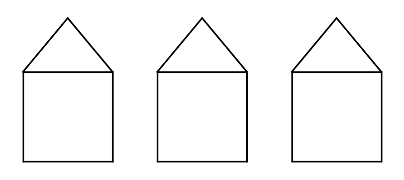

# COMP 170 — Points and Houses

In this assignment you write a `Point` class, use it from a separate program, and then use your points to draw houses with Python's `turtle` module.

## Instructions

- Use Python constructs covered in our course materials.
- Give every function and method type annotations and a one-line docstring.
- Build strings with `+` and `str()`. Do not use f-strings.
- Keep the class in `point.py` and your program in `house.py`, in the same folder. The program uses `main()` and calls it under `if __name__ == "__main__":`.
- Submit `point.py` and `house.py`.

## Part A — The Point class

### 1. Write the Point class

A `Point` object represents a location (x, y) in the plane. Create `point.py` and start it with this code:

```python
"""A Point class for points in the plane."""

import math


class Point:
    """A point (x, y) in the plane."""

    def __init__(self, x: float, y: float) -> None:
        """Create a point with the given coordinates."""
        self.x = x
        self.y = y
```

Add the following methods to `Point`.

a) `get_x(self) -> float` and `get_y(self) -> float`: Return the x- and y-coordinates.

b) `set_x(self, x: float) -> None` and `set_y(self, y: float) -> None`: Replace the x- or y-coordinate with a new value.

c) `translate(self, dx: float, dy: float) -> None`: Move the point `dx` units horizontally and `dy` units vertically. A positive `dx` moves the point right and a negative `dx` moves it left; a positive `dy` moves it up and a negative `dy` moves it down. So the new coordinates are x + dx and y + dy. For example, translating (3, 4) by `dx = -5` and `dy = 10` moves it to (-2, 14).

d) `distance(self, other: "Point") -> float`: Return the straight-line distance between this point and `other`:

   d = √((x₂ − x₁)² + (y₂ − y₁)²)

   Use `math.sqrt`. For example, the distance from (-2, 1) to (4, 9) is `10.0`. (The quotes in `"Point"` let a method of `Point` use its own class as a type.)

e) `__str__(self) -> str`: Return text such as `(-200, -100)`.

### 2. Four corners of a square

Create `house.py` in the same folder and import your class with `from point import *`. In `main()`:

a) Create four `Point` objects named `bottom_left`, `bottom_right`, `top_right`, and `top_left` that are the corners of a square with sides of length 100. The bottom-left corner is at x = -200, y = -100; work out the other three.

b) Print the four points.

c) Use `distance` to print the length of one side and of one diagonal (rounded to two decimals), and check that they are what you expect for a square.

d) Test the rest of your class: print one point's coordinates with `get_x` and `get_y`, and try `translate`, `set_x`, and `set_y` on an extra point of your own.

## Part B — Drawing houses

**Drawing with turtle.** The `turtle` module comes with Python, so there is nothing to install. It draws in a window whose center is (0, 0), with x increasing to the right and y increasing upward, just like your points. Think of a pen that you lift and lower. You only need these commands:

```python
import turtle

pen = turtle.Turtle()
pen.hideturtle()       # hide the arrow
pen.penup()            # lift the pen: moving now draws nothing
pen.goto(-100, 50)     # move to (-100, 50)
pen.pendown()          # lower the pen: moving now draws a line
pen.goto(100, 50)      # draws a line to (100, 50)
turtle.done()          # keep the window open until you close it
```

A `goto` needs two numbers, so give it a point's coordinates: `pen.goto(p.get_x(), p.get_y())`. Do not name any file `turtle.py`, because Python would import your file instead of the module.

### 3. Draw one house

The square from Exercise 2 is the bottom of the house, and a triangular roof sits on top of it.

a) In `house.py`, write a function `draw_line(pen: turtle.Turtle, start: Point, end: Point) -> None` that draws a line segment between two points. Lift the pen, go to `start`, lower the pen, then go to `end`.

b) Write a function `draw_house(pen, bottom_left, bottom_right, top_right, top_left, peak) -> None` (with type annotations) that uses `draw_line` six times: four times for the sides of the square, and twice for the roof, from `top_left` to `peak` and from `peak` to `top_right`.

c) In `main()`, create the roof's `peak` at (-150, 60), halfway across the square and 60 above its top. Create a pen, call `draw_house` with your five points, and end with `turtle.done()`.

### 4. Three houses in a row

Change `main()` so that it draws three identical houses side by side, 150 units apart, as in the picture below. Do not create new points for the second and third houses.



**Hint:** after drawing a house, use the `translate` method you wrote in Exercise 1 to move each of the five points 150 units to the right, then call `draw_house` again. A loop can repeat this for you.
